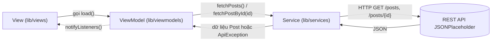

# Posts Reader

Ứng dụng Flutter đọc bài viết từ REST API [JSONPlaceholder](https://jsonplaceholder.typicode.com), gồm màn danh sách và màn chi tiết bài viết. Đây là ứng dụng demo cho Chủ đề 4: Kiến trúc MVVM & Quản lý trạng thái tách biệt, môn Lập trình đa nền tảng, Khoa Điện tử - Viễn thông, Trường Đại học Bách Khoa - Đại học Đà Nẵng. Dữ liệu là dữ liệu giả của JSONPlaceholder: 100 bài viết với nội dung lorem ipsum.

## Kiến trúc MVVM

Không dùng package quản lý trạng thái bên ngoài: ViewModel kế thừa `ChangeNotifier`, View lắng nghe bằng `ListenableBuilder` có sẵn trong Flutter. Package ngoài duy nhất là `http`.



### Cấu trúc thư mục

```text
lib/
├── main.dart                        # Composition root: tạo PostService, truyền hàm tạo ViewModel vào View
├── models/
│   └── post.dart                    # Model Post; Post.fromJson là nơi duy nhất chuyển JSON thành Post
├── services/
│   ├── api_exception.dart           # ApiErrorType và ApiException (thông báo tiếng Việt, isRetryable)
│   └── post_service.dart            # GET /posts và /posts/{id}, timeout 10 giây, mọi lỗi đổi thành ApiException
├── viewmodels/
│   ├── base_view_model.dart         # LoadStatus và lớp cha: status, errorMessage, canRetry, runLoad()
│   ├── post_list_view_model.dart    # posts (chỉ đọc) và load()
│   └── post_detail_view_model.dart  # post và load()
└── views/
    ├── post_list_view.dart          # Màn danh sách, bấm một dòng để mở màn chi tiết
    ├── post_detail_view.dart        # Màn chi tiết: tiêu đề và nội dung bài viết
    └── widgets/
        └── error_retry_view.dart    # Thông báo lỗi và nút "Thử lại" (ẩn khi onRetry là null)
test/
├── services/
│   └── post_service_test.dart       # PostService với MockClient của package http
├── viewmodels/
│   ├── post_list_view_model_test.dart    # PostListViewModel với FakePostService viết trong file
│   └── post_detail_view_model_test.dart  # PostDetailViewModel với FakePostService viết trong file
└── views/
    ├── fake_post_service.dart       # Service giả dùng chung cho widget test
    ├── post_list_view_test.dart     # Widget test màn danh sách
    └── post_detail_view_test.dart   # Widget test màn chi tiết
```

### Luồng dữ liệu một chiều

1. Khi mở màn hình, `initState` tạo ViewModel (qua hàm được truyền từ `main.dart`) và gọi `load()`. Nút "Thử lại" cũng gọi lại `load()`.
2. `load()` chạy `runLoad()`: đặt `status = LoadStatus.loading`, gọi `notifyListeners()`, rồi gọi `PostService`.
3. Service trả về dữ liệu hoặc ném `ApiException`. ViewModel lưu dữ liệu, đặt `status` thành `success` hoặc `error` (kèm `errorMessage`, `canRetry`) và gọi `notifyListeners()` lần nữa.
4. `ListenableBuilder` trong View nhận thông báo và vẽ lại theo `switch (status)`.
5. View chỉ đọc state qua getter (`status`, `posts`, `post`, `errorMessage`, `canRetry`) và không tự đổi state. Khi rời màn hình, State gọi `dispose()`; ViewModel bỏ qua `notifyListeners()` sau khi bị dispose nên request đang chạy dở không gây lỗi.

### Ba trạng thái hiển thị

| `LoadStatus` | View hiển thị |
|---|---|
| `loading` | `CircularProgressIndicator` ở giữa màn hình |
| `success` | Danh sách bài viết, hoặc tiêu đề và nội dung ở màn chi tiết |
| `error` | `ErrorRetryView`: biểu tượng lỗi, `errorMessage` và nút "Thử lại" nếu `canRetry` là `true` |

| Loại lỗi | Khi nào | Thông báo | Nút "Thử lại" |
|---|---|---|---|
| `network` | `ClientException` hoặc quá 10 giây | Không thể kết nối tới máy chủ. Vui lòng kiểm tra mạng. | Có |
| `server` | HTTP status ngoài 2xx, trừ 404 | Máy chủ trả về lỗi (mã `statusCode`). | Có |
| `notFound` | HTTP 404 | Không tìm thấy bài viết. | **Không** |
| `parse` | JSON sai cú pháp, thiếu field hoặc sai kiểu | Dữ liệu từ máy chủ không hợp lệ. | Có |
| Lỗi khác | Lỗi không phải `ApiException` | Đã xảy ra lỗi không xác định. | Có |

Với lỗi không tìm thấy bài viết, `canRetry = false` (vì `ApiException.isRetryable` là `type != notFound`), View truyền `onRetry: null` nên nút "Thử lại" không xuất hiện: thử lại cũng không có kết quả khác.

## Quy tắc tách tầng

- View (`lib/views`) không import `services/`, `package:http`, `dart:convert` và không gọi `jsonDecode` hay `fromJson`. View chỉ biết ViewModel và model `Post`.
- Chỉ `lib/main.dart` tạo `PostService`, rồi truyền hàm tạo ViewModel vào View.

Kiểm tra quy tắc của View, kết quả đúng là **không in ra gì**. Windows (cmd hoặc PowerShell):

```bat
findstr /s /i /m "services/ package:http dart:convert jsonDecode fromJson" lib\views\*.dart
```

Linux/macOS:

```bash
grep -rnE "services/|package:http|dart:convert|jsonDecode|fromJson" lib/views
```

## Yêu cầu và cài đặt

### Công cụ cần có

- Flutter SDK đi kèm Dart `>= 3.13.0 < 4.0.0` (ràng buộc `sdk: ^3.13.0` trong `pubspec.yaml`). Đã kiểm tra với Flutter 3.47.7 (Dart 3.13.5).
- Git.
- Android Studio hoặc Android SDK (kiểm tra bằng `flutter doctor`).
- Điện thoại Android đã bật USB debugging, hoặc máy ảo Android (kiểm tra bằng `flutter devices`).

### Cài đặt và chạy

```bash
git clone https://github.com/cityengin/posts-reader.git
cd posts-reader
flutter pub get
flutter run
```

Chạy bản release (không có hot reload, hiệu năng gần với thực tế):

```bash
flutter run --release
```

### Cấu hình

- Ứng dụng **không** cần file `.env`, `google-services.json` hay API key; chỉ cần kết nối Internet.
- Quyền Internet đã được khai báo trong `android/app/src/main/AndroidManifest.xml` (`<uses-permission android:name="android.permission.INTERNET"/>`). Dòng này cần cho bản release; bản debug và profile đã có quyền này trong `android/app/src/debug/` và `android/app/src/profile/`.
- Địa chỉ API mặc định là `https://jsonplaceholder.typicode.com`, có thể đổi qua tham số `baseUrl` của constructor, ví dụ trong `lib/main.dart`: `PostService(baseUrl: 'https://api.example.com')`.

## Kiểm thử

```bash
flutter analyze
flutter test
```

Kết quả hiện tại: `flutter analyze` không có lỗi, `flutter test` pass 18/18 test. Không test nào gọi mạng thật.

| Nhóm | File | Số test | Kiểm tra |
|---|---|---|---|
| Service | `test/services/post_service_test.dart` | 7 | Gọi đúng URL `/posts`, `/posts/{id}` và parse đúng `Post` (kể cả tiếng Việt UTF-8); 404 thành `notFound`; 500 thành `server` kèm `statusCode`; `ClientException` thành `network`; body không phải JSON và JSON thiếu field thành `parse` |
| ViewModel | `test/viewmodels/post_list_view_model_test.dart`, `test/viewmodels/post_detail_view_model_test.dart` | 4 + 2 | Trạng thái `loading` rồi `success`; lỗi server cho `error` và `canRetry = true`; gọi lại `load()` sau lỗi thì thành công; dispose khi đang tải không lỗi; `notFound` cho `canRetry = false` |
| View | `test/views/post_list_view_test.dart`, `test/views/post_detail_view_test.dart` | 3 + 2 | Vòng xoay lúc tải rồi hiện danh sách; lỗi mạng hiện thông báo và nút "Thử lại", bấm thì hiện danh sách; bấm một dòng mở màn chi tiết; `notFound` không có nút "Thử lại"; hiện tiêu đề và nội dung khi thành công |

## Phân công nhóm

| Phần việc | Người làm | Mảng |
|---|---|---|
| `models/`, `services/`, `viewmodels/` và test tương ứng | Thắng | Business Logic, State Management, API |
| `views/`, `main.dart` (nối ViewModel), widget test | Thái | UI Design |
| Báo cáo / Slide | Cả hai | |

## Dữ liệu và giấy phép

- Nguồn dữ liệu: https://jsonplaceholder.typicode.com, một REST API giả miễn phí dùng để thử nghiệm. Ứng dụng chỉ đọc dữ liệu (GET), nội dung bài viết là lorem ipsum, không phải nội dung thật.
- Repo chưa có file `LICENSE`.
